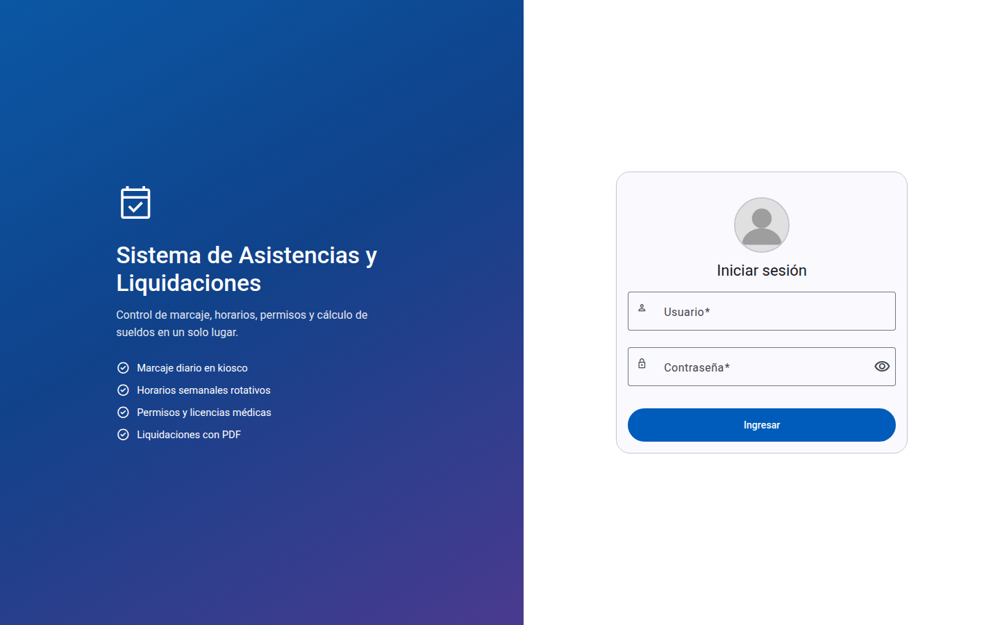
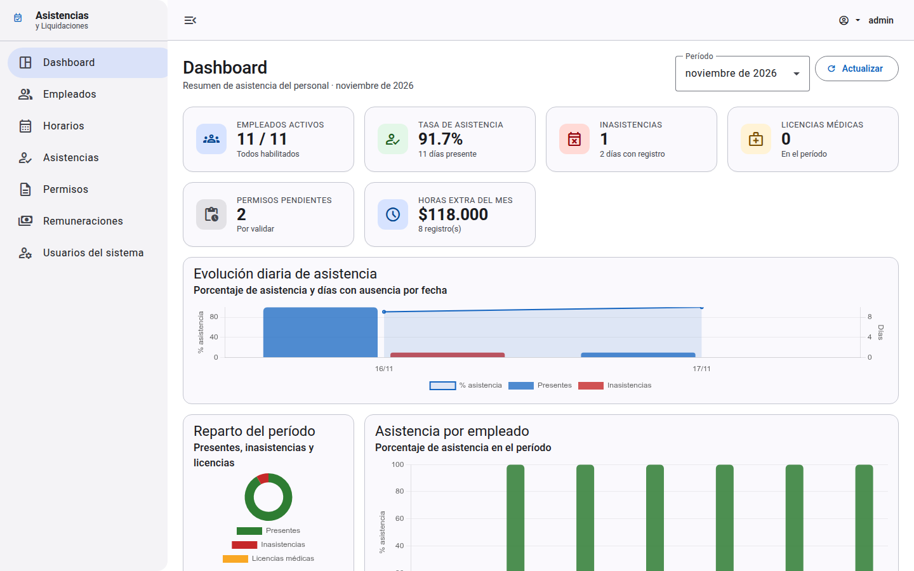
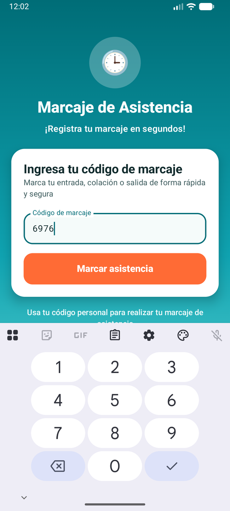

# Sistema de Asistencias y Liquidaciones (Chile)

Sistema completo de gestión de asistencia y liquidaciones de sueldos, con lógica
de legislación laboral chilena (jornadas con colación, permisos por hora/día,
compensación, asignación familiar, AFP/salud/cesantía, impuesto único).

El proyecto tiene tres partes:

| Carpeta    | Descripción                                             |
|------------|---------------------------------------------------------|
| `backend/` | API REST (Spring Boot 4.0.8, Java 17, MySQL por defecto) |
| `frontend/`| Aplicación web (Angular 21 + Angular Material)        |
| `android/` | App Android de marcaje (Kotlin + Jetpack Compose)       |

---
Usuario del sistema es admin
Contraseña admin123
---

## Capturas del sistema

### Frontend (web)

| Inicio de sesión | Dashboard (KPIs y gráficos) |
|------------------|-----------------------------|
|  |  |

| Empleados | Control de asistencia |
|-----------|-----------------------|
|  |  |


*Remuneraciones: liquidaciones del período, horas extra, anticipos y licencias.*

### App Android

| Kiosco de marcaje | Código ingresado |
|-------------------|------------------|
|  |  |

*Kiosco de marcaje: el trabajador ingresa su código de 4 dígitos y la app registra
la siguiente marca del día (entrada, colaciones o salida).*


*Marcaje con un empleado real: María José González Rojas (código 6977), con la
entrada registrada y el siguiente paso indicado por la app.*

### Diagramas

- [Arquitectura general](docs/imagenes/arquitectura.svg) ·
  [Módulos y funcionalidades](docs/imagenes/modulos.svg) ·
  [Flujo de marcaje](docs/imagenes/flujo-marcaje.svg)

---

## Requisitos del sistema

### Software

| Componente | Versión / detalle |
|------------|-------------------|
| JDK | 17 (usado por backend y Android) |
| Backend | Maven Wrapper incluido (`backend/mvnw`), Spring Boot 4.0.8 |
| Base de datos | MySQL 8 (esquema `sistema_asis`); H2 para los tests |
| Frontend | Node.js 18+ y npm 10+ (Angular CLI 21) |
| Android | Android Studio LadyBug o superior, Android SDK 35, JDK 17 |
| Dispositivo Android | Emulador con API 24+ o dispositivo físico con `minSdk 24` |
| Navegador | Chrome/Edge/Firefox moderno para el frontend |

### Puertos y acceso

- Backend: `http://localhost:8080`
- Frontend: `http://localhost:4200` (proxy `/api` al backend)
- MySQL: `localhost:3306`
- Emulador Android → backend del host: `http://10.0.2.2:8080/`
- Dispositivo físico → backend del host: usar la IP de la red local
  (p. ej. `http://192.168.1.10:8080/`)
- Usuario inicial: `admin` / `admin123`

### Recursos recomendados para desarrollo

- 4 núcleos de CPU, 8 GB de RAM y ~10 GB libres
  (SDK de Android + emulador + dependencias).
- Conexión a red local para probar el marcaje desde un dispositivo físico.

---

## Tecnologías utilizadas

| Capa | Tecnologías |
|------|-------------|
| Backend | Java 17, Spring Boot 4.0.8 (Web MVC, Data JPA, Validation, Security), Spring Security 7 + JWT (`jjwt` 0.12.6), BCrypt, Hibernate 7.2, MySQL 8 / H2 (tests), HikariCP, OpenPDF 1.3.30, Lombok, Maven |
| Frontend | Angular 21 (standalone components, signals, zoneless), Angular Material 21 (M3), TypeScript 5.9, RxJS 7.8, Chart.js 4.5 + ng2-charts 10, SweetAlert2, SCSS, Angular CLI/npm, Vitest |
| Android | Kotlin 2.0.20, Jetpack Compose (Material 3, BOM 2024.09.03), ViewModel + StateFlow, Retrofit + OkHttp + Gson, DataStore, Gradle 8.9 / AGP 8.5.2 (`minSdk 24`, `targetSdk 35`) |
| Entorno | API REST JSON sobre HTTP, autenticación JWT stateless, CORS para desarrollo local, perfiles H2 para pruebas |

El detalle de requisitos funcionales, no funcionales y alcance está en
[`docs/REQUISITOS_Y_TECNOLOGIAS.md`](docs/REQUISITOS_Y_TECNOLOGIAS.md).

Para subir la aplicación a un servidor propio con Docker, ver
[`docs/DESPLIEGUE_DOCKER.md`](docs/DESPLIEGUE_DOCKER.md).

---

## 1. Backend (API REST)

1. Crear la base de datos en MySQL. La configuración por defecto ya apunta a la
   base del servidor (`100.73.41.33:3306/sistema_asis`, usuario `dev`):
   ```sql
   CREATE DATABASE sistema_asis;
   ```
2. La contraseña **no** se guarda en `application.properties`: se inyecta con la
   variable `DB_PASSWORD` desde `.env` (ver
   [`docs/DESPLIEGUE_DOCKER.md`](docs/DESPLIEGUE_DOCKER.md)). Para desarrollo
   local se puede sobrescribir temporalmente `DB_URL`, `DB_USERNAME` y
   `DB_PASSWORD` con variables de entorno.
3. Si ya tenías la base creada con los nombres de tabla en inglés, ejecuta
   **una sola vez** el script de migración (con la aplicación detenida):
   ```bash
   mysql -uroot -p sistema_asis < migracion_nombres_espanol.sql
   ```
4. Ejecutar (desde `backend/`):
   ```bash
   ./mvnw spring-boot:run
   ```
   El servidor queda en `http://localhost:8080`.

   Usuario admin por defecto: `admin` / `admin123`.

5. Ejecutar los tests (85 tests de unidad e integración, usan H2):
   ```bash
   ./mvnw test
   ```

### Modelo de datos

Todas las entidades JPA y sus tablas están en español:

| Entidad           | Tabla                     |
|-------------------|---------------------------|
| `Empleado`        | `empleados`               |
| `Usuario`         | `usuarios`                |
| `Asistencia`      | `asistencias`             |
| `HorarioSemanal`  | `horarios_semanales`      |
| `DiaHorario`      | `dias_horario_semanal`    |
| `PermisoLaboral`  | `permisos_laborales`      |
| `Liquidacion`     | `liquidaciones`           |
| `LiquidacionDetalle` | `liquidacion_detalle`   |
| `Anticipo`        | `anticipos`               |
| `LicenciaMedica`  | `licencias_medicas`       |
| `HoraExtra`       | `horas_extra`             |
| `ParametroSistema`| `parametros_sistema`      |

Los DTOs y los contratos JSON de la API conservan sus nombres en inglés
(`EmployeeResponse`, `AttendanceResponse`, …) para no romper los clientes
(frontend y app Android).

### Reglas de negocio

- **Licencias médicas**: el empleador no paga la licencia. Todos los días
  solapados de una licencia se descuentan del sueldo del trabajador, por lo que
  no existe un haber de subsidio patronal. Las columnas
  `licencias_medicas.employer_pays` y
  `liquidaciones.subsidio_licencia_empleador` se conservan en la base de datos
  solo por compatibilidad (`migracion_sin_subsidio_licencia.sql` las deja con
  default `0`), pero el código y la API ya no las utilizan.
- **Control de asistencia**: la vista es maestro/detalle. Se listan todos los
  empleados y, al seleccionar uno, se muestra su asistencia del período. No
  existe un endpoint masivo: cada consulta va a
  `GET /api/attendance/employee/{id}`.
- **Liquidación de sueldo**: el anticipo del período se descuenta junto con el
  resto de los descuentos y aparece como una línea normal
  `Anticipo de sueldo — DESCUENTO`, sin una sección aparte.

---

## 2. Frontend (web)

Desde `frontend/`:

```bash
npm install
npm start           # http://localhost:4200
```

Angular CLI está configurado con proxy `/api` → `http://localhost:8080`
(`proxy.conf.json`), así que debe estar corriendo el backend. Para producción:

```bash
npm run build       # salida en dist/sistema-asistencias
```

Incluye un **dashboard** con KPIs y gráficos de asistencia del personal, y
paneles de administración: empleados, horarios semanales (con descarga de PDF),
control de asistencia, permisos laborales y remuneraciones (liquidaciones,
anticipos, licencias médicas y horas extra). El marcaje por RUT se hace desde la
app Android.

### Stack

- Angular 21 (standalone components, signals, zoneless).
- Angular Material 21 con tema M3 y `ng2-charts` + Chart.js para el dashboard.
- Carga perezosa por ruta (`loadComponent`) y servicios con `HttpClient`.

---

## 3. App Android (marcaje)

El proyecto Android está en `android/` y se abre y compila desde
**Android Studio** (o con `./gradlew` si se cuenta con el SDK configurado):

1. Abrir la carpeta `android/` con Android Studio (importar como proyecto Gradle).
2. Gradle 8.9 y las dependencias se descargan automáticamente.
3. Ejecutar sobre un emulador o dispositivo físico.

La base URL de la API está en
`android/app/src/main/java/cl/ipfsoft/backend/app/data/RetrofitClient.kt`:

- `http://10.0.2.2:8080/` → `localhost` de la máquina vista desde el **emulador**.
- Para **dispositivo físico**, cambiar por la IP local de la máquina
  (p. ej. `http://192.168.1.10:8080/`).
- Con el despliegue Docker en el servidor propio: `http://IP_DEL_SERVIDOR/api/`.

### Funcionalidades de la app

- **Kiosco**: marcaje público por RUT (entrada, colaciones y salida), con
  indicación del siguiente paso del día.
- **Portal del empleado**: consulta de su propia asistencia, permisos y
  liquidaciones con la sesión JWT guardada en DataStore.

### Notas técnicas Android

- Kotlin 2.0.20, AGP 8.5.2, Compose BOM 2024.09.03, minSdk 24 / targetSdk 35.
- `usesCleartextTraffic=true` para permitir HTTP en desarrollo; en producción
  debe usarse HTTPS.
- Se incluye el wrapper `gradlew` y `gradle/wrapper/gradle-wrapper.properties`
  (Gradle 8.9).

---

## Contratos de la API consumidos por el frontend/Android

- `POST /api/auth/login` — iniciar sesión.
- `POST /api/attendance/mark` (público) — marcar el siguiente paso por RUT.
- `POST /api/attendance/status` (público) — consultar estado del día.
- `GET /api/attendance/employee/{id}` — asistencias de un empleado.
- `GET /api/permisos/employee/{id}` — permisos de un empleado.
- `GET /api/payroll/liquidaciones/employee/{employeeId}` — liquidaciones de un empleado.
- `GET /api/payroll/liquidaciones/{id}/pdf` — PDF de la liquidación, en una sola
  hoja, con el bloque de firma del trabajador y nombre de archivo
  `Liquidación_<Empleado>_<Mes>_<Año>.pdf` (UTF-8 vía `filename*`, con fallback
  ASCII para clientes antiguos).
- CRUD de empleados, asistencia (admin), permisos (admin/empleado) y
  liquidaciones (admin) según las reglas de negocio del sistema.
