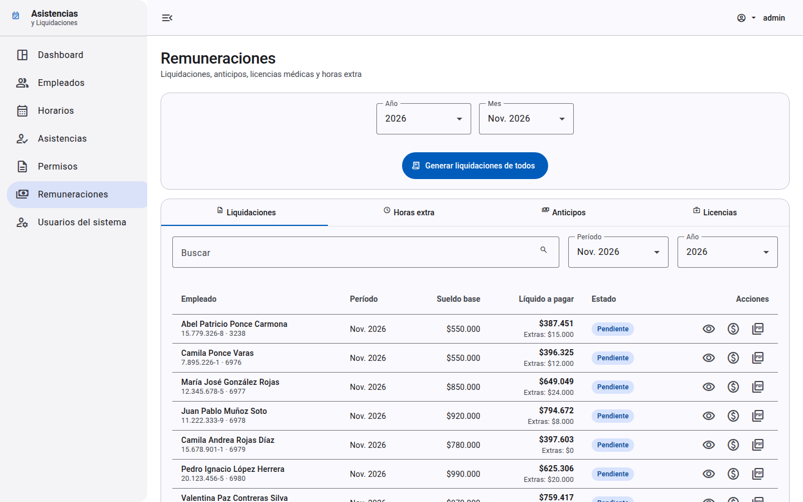
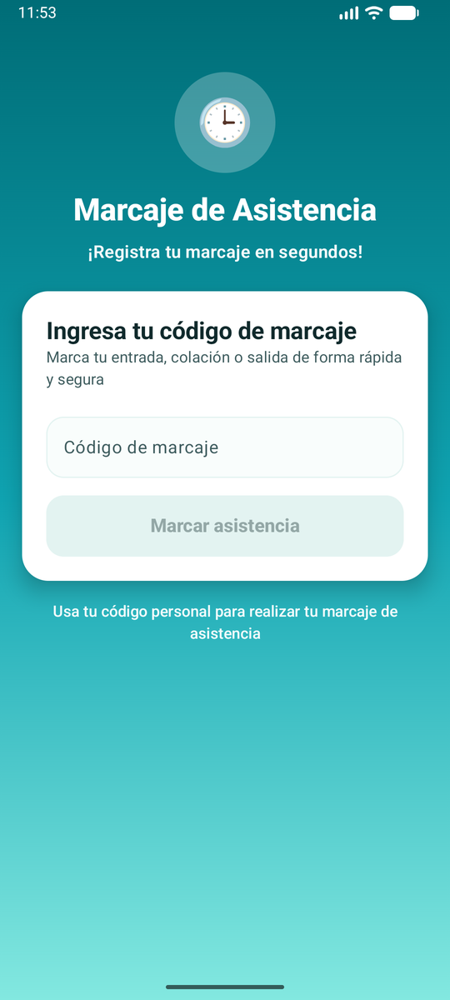
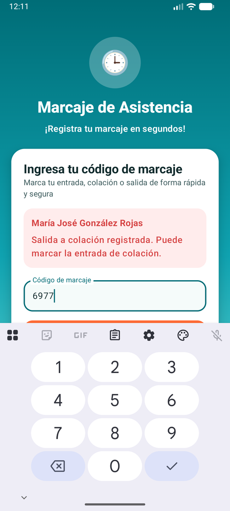

# Sistema de Asistencias y Liquidaciones (Chile)

Sistema completo de gestión de asistencia y liquidaciones de sueldos, con lógica
de legislación laboral chilena (jornadas con colación, permisos por hora/día,
compensación, asignación familiar, AFP/salud/cesantía, impuesto único).

El proyecto tiene tres partes:

| Carpeta    | Descripción                                             |
|------------|---------------------------------------------------------|
| `backend/` | API REST (Spring Boot 4.0.8, Java 17, MySQL por defecto) |
| `frontend/`| Aplicación web (Angular 21 + Angular Material)        |
| `android/` | App Android de marcaje (Kotlin + Jetpack Compose)       |

## Capturas del sistema

### Frontend (web)

| Inicio de sesión | Dashboard (KPIs y gráficos) |
|------------------|-----------------------------|
|  |  |

| Empleados | Control de asistencia |
|-----------|-----------------------|
|  |  |



*Remuneraciones: liquidaciones del período, horas extra, anticipos y licencias.*

### App Android

| Kiosco de marcaje | Código ingresado |
|-------------------|------------------|
|  |  |

*Kiosco de marcaje: el trabajador ingresa su código de 4 dígitos y la app registra
la siguiente marca del día (entrada, colaciones o salida).*



*Marcaje con un empleado real: María José González Rojas (código 6977), con la
entrada registrada y el siguiente paso indicado por la app.*

### Diagramas

- [Arquitectura general](docs/imagenes/arquitectura.svg) ·
  [Módulos y funcionalidades](docs/imagenes/modulos.svg) ·
  [Flujo de marcaje](docs/imagenes/flujo-marcaje.svg)

---

## Requisitos del sistema

### Software

| Componente | Versión / detalle (verificada en este entorno) |
|------------|------------------------------------------------|
| JDK | Java 17.0.15 LTS (usado por backend y Android) |
| Backend | Maven Wrapper incluido (`backend/mvnw`), Spring Boot 4.0.8 |
| Base de datos | MySQL 8.4.11 local / 8.4.13 en el servidor (esquema `sistema_asis`); H2 para los tests |
| Frontend | Node.js 22.23.4 y npm 10.9.9 (Angular CLI 21.2.24) |
| Android | Android Studio LadyBug o superior, Android SDK 35, JDK 17 |
| Gradle | 8.9 (wrapper incluido), AGP 8.5.2, Kotlin 2.0.20 |
| Dispositivo Android | Emulador con API 24+ o dispositivo físico con `minSdk 24` |
| Navegador | Chrome/Edge/Firefox moderno para el frontend |
| Docker | Docker Engine con plugin `compose` (o Docker Desktop) para ejecutar MySQL + backend + frontend en contenedores |

### Puertos y acceso

- Backend: `http://localhost:8080`
- Frontend: `http://localhost:4200` (proxy `/api` al backend)
- MySQL del sistema: `localhost:3306`
- MySQL en Docker Compose: `localhost:3307` (o `MYSQL_HOST_PORT`)
- Backend expuesto por Compose: `http://localhost:8080` (o `BACKEND_PORT`)
- **Android (configuración por defecto en el repo): `http://10.0.2.2:8080/`**
  (el emulador ve el `localhost` del host con esa IP).
- Dispositivo físico → backend del host: usar la IP de la red local
  (p. ej. `http://192.168.1.10:8080/`).
- Con Docker Compose: `http://localhost:8081` (proxy `/api` al backend).

### Recursos recomendados para desarrollo

- 4 núcleos de CPU, 8 GB de RAM y ~10 GB libres
  (SDK de Android + emulador + dependencias).
- Conexión a red local para probar el marcaje desde un dispositivo físico.

---

## Tecnologías utilizadas

| Capa | Tecnologías |
|------|-------------|
| Backend | Java 17.0.15, Spring Boot 4.0.8 (Web MVC, Data JPA, Validation, Security), Spring Security + JWT (`jjwt` 0.12.6), BCrypt, Hibernate, MySQL 8.4 / H2 (tests), HikariCP, OpenPDF 1.3.30, Lombok, Maven |
| Frontend | Angular 21.2.x (standalone components, signals, zoneless), Angular Material 21.2.x (M3), TypeScript 5.9, RxJS 7.8, Chart.js 4.5 + ng2-charts 10, SweetAlert2 11, SCSS, Angular CLI 21.2.24 / npm 10.9.9, Vitest 4 |
| Android | Kotlin 2.0.20, Jetpack Compose (Material 3, BOM 2024.09.03), ViewModel + StateFlow, Retrofit 2.11 + OkHttp 4.12 + Gson 2.11, DataStore 1.1.1, JWT en cabecera `Authorization`, Gradle 8.9 / AGP 8.5.2 (`minSdk 24`, `targetSdk 35`) |
| Docker | Docker Engine + plugin `compose`, `docker-compose.yml` con servicios `mysql:8.4`, backend y frontend, `backend/Dockerfile` (multi-stage `maven:3.9-eclipse-temurin-17` → `eclipse-temurin:17-jre-jammy`), `frontend/Dockerfile` (multi-stage `node:20-alpine` → `nginx:1.27-alpine`), `frontend/nginx.conf` (proxy `/api`), `scripts/deploy.sh` |
| Entorno | MySQL 8.4 en contenedor con volumen persistente, API REST JSON sobre HTTP, autenticación JWT stateless, CORS local, perfiles H2 para pruebas |

El detalle de requisitos funcionales, no funcionales y alcance está en
[`docs/REQUISITOS_Y_TECNOLOGIAS.md`](docs/REQUISITOS_Y_TECNOLOGIAS.md).

Para ejecutar la aplicación con Docker Compose, ver
[`docs/DESPLIEGUE_DOCKER.md`](docs/DESPLIEGUE_DOCKER.md).

---

## Qué hace y qué NO hace el sistema

### ✅ Lo que hace

| Área | Funcionalidad implementada |
|------|----------------------------|
| Autenticación | Login con usuario/contraseña, JWT stateless, BCrypt, roles `ADMIN`, `SUPERVISOR` y `EMPLOYEE`, cambio de contraseña y avatar. |
| Usuarios | Alta/edición de usuarios del sistema, habilitar/deshabilitar, foto y perfil. |
| Empleados | CRUD completo (RUT, datos laborales, sueldo base, AFP/salud, cargas), validación de RUT, alta/baja/eliminación. |
| Horarios | Horarios semanales por empleado con días y colaciones, autoformato de horas (`0730` → `07:30`) y descarga de PDF. |
| Asistencia | Marcaje por código de 4 dígitos (entrada, colaciones, salida), consulta por empleado/rango, correcciones administrativas, ausencias y licencias médicas. |
| Permisos | Solicitudes por horas o días, aprobación/rechazo y compensación/devolución. |
| Remuneraciones | Licencias médicas, horas extra, anticipos y liquidación mensual con reglas chilenas (gratificación, asignación familiar, AFP/salud/cesantía, impuesto único, descuentos). |
| Liquidaciones | Generación individual y masiva, detalle, marcar como pagada y PDF de una hoja con firma. |
| Dashboard | KPIs y gráficos de asistencia del período por empleado. |
| Web | Panel administrativo con Angular Material, rutas protegidas y proxy `/api`. |
| Android | Kiosco de marcaje y portal del empleado con sesión JWT persistida y selector de empleado. |
| Despliegue | Docker Compose (MySQL + backend + nginx), proxy `/api`, CORS configurable y volumen persistente para la BD. |

### ❌ Lo que NO hace (fuera de alcance)

- **No** conecta la app Android ni el frontend directamente a MySQL: ambos
  consumen la API REST; solo el backend accede a la base de datos.
- **No** reemplaza asesoría legal, tributaria, contable ni laboral: los cálculos
  requieren validación normativa según la empresa.
- **No** integra pagos bancarios, transferencias, Previred, SII ni sistemas RRHH
  externos.
- **No** incluye firma electrónica avanzada ni flujos documentales complejos más
  allá de los PDF generados.
- **No** implementa biometría, geolocalización, reconocimiento facial ni control
  de dispositivo para el marcaje (es solo por código).
- **No** tiene portal de autoservicio web para empleados: el autoservicio es el
  portal Android (consulta y marcaje).
- **No** soporta multiempresa/multitenencia ni internacionalización completa.
- **No** envía notificaciones push, correo ni SMS; **no** funciona sin conexión
  (no hay modo offline ni sincronización diferida).
- **No** exporta a Excel: los reportes descargables son PDF.
- **No** provee HTTPS, rate limiting, auditoría avanzada ni recuperación de
  contraseña por correo sin configuración/implementación adicional.
- **No** usa migraciones controladas: el esquema se actualiza con
  `JPA_DDL_AUTO=update`, por lo que se recomienda respaldo antes de actualizar.

> Para el detalle completo de requisitos y tecnologías, ver
> [`docs/REQUISITOS_Y_TECNOLOGIAS.md`](docs/REQUISITOS_Y_TECNOLOGIAS.md).

---

## 1. Backend (API REST)

1. Crear la base de datos en MySQL si ejecutas el backend fuera de Docker. La
   configuración por defecto apunta a `localhost:3306/sistema_asis` (usuario
   `dev`). Con Docker Compose no hay que crearla: el servicio `mysql` la crea
   automáticamente con `MYSQL_DATABASE`.
   ```sql
   CREATE DATABASE sistema_asis;
   ```
2. La contraseña **no** se guarda en `application.properties`: se inyecta con la
   variable `DB_PASSWORD` desde `.env` (ver
   [`docs/DESPLIEGUE_DOCKER.md`](docs/DESPLIEGUE_DOCKER.md)). Para desarrollo
   local se puede sobrescribir temporalmente `DB_URL`, `DB_USERNAME` y
   `DB_PASSWORD` con variables de entorno.
3. Si ya tenías la base creada con los nombres de tabla en inglés, ejecuta
   **una sola vez** el script de migración (con la aplicación detenida):
   ```bash
   mysql -uroot -p sistema_asis < migracion_nombres_espanol.sql
   ```
4. Ejecutar (desde `backend/`):
   ```bash
   ./mvnw spring-boot:run
   ```
   El servidor queda en `http://localhost:8080`.

   Las credenciales del administrador se definen en `.env` mediante
   `ADMIN_USERNAME` y `ADMIN_PASSWORD` (ver
   [`docs/DESPLIEGUE_DOCKER.md`](docs/DESPLIEGUE_DOCKER.md)).

5. Ejecutar los tests (85 tests de unidad e integración, usan H2):
   ```bash
   ./mvnw test
   ```

### Modelo de datos

Todas las entidades JPA y sus tablas están en español:

| Entidad           | Tabla                     |
|-------------------|---------------------------|
| `Empleado`        | `empleados`               |
| `Usuario`         | `usuarios`                |
| `Asistencia`      | `asistencias`             |
| `HorarioSemanal`  | `horarios_semanales`      |
| `DiaHorario`      | `dias_horario_semanal`    |
| `PermisoLaboral`  | `permisos_laborales`      |
| `Liquidacion`     | `liquidaciones`           |
| `LiquidacionDetalle` | `liquidacion_detalle`   |
| `Anticipo`        | `anticipos`               |
| `LicenciaMedica`  | `licencias_medicas`       |
| `HoraExtra`       | `horas_extra`             |
| `ParametroSistema`| `parametros_sistema`      |

Los DTOs y los contratos JSON de la API conservan sus nombres en inglés
(`EmployeeResponse`, `AttendanceResponse`, …) para no romper los clientes
(frontend y app Android).

### Reglas de negocio

- **Licencias médicas**: el empleador no paga la licencia. Todos los días
  solapados de una licencia se descuentan del sueldo del trabajador, por lo que
  no existe un haber de subsidio patronal. Las columnas
  `licencias_medicas.employer_pays` y
  `liquidaciones.subsidio_licencia_empleador` se conservan en la base de datos
  solo por compatibilidad (`migracion_sin_subsidio_licencia.sql` las deja con
  default `0`), pero el código y la API ya no las utilizan.
- **Control de asistencia**: la vista es maestro/detalle. Se listan todos los
  empleados y, al seleccionar uno, se muestra su asistencia del período. No
  existe un endpoint masivo: cada consulta va a
  `GET /api/attendance/employee/{id}`.
- **Liquidación de sueldo**: el anticipo del período se descuenta junto con el
  resto de los descuentos y aparece como una línea normal
  `Anticipo de sueldo — DESCUENTO`, sin una sección aparte.

---

## 2. Frontend (web)

Desde `frontend/`:

```bash
npm install
npm start           # http://localhost:4200
```

Angular CLI está configurado con proxy `/api` → `http://localhost:8080`
(`proxy.conf.json`), así que debe estar corriendo el backend. Para producción:

```bash
npm run build       # salida en dist/sistema-asistencias
```

Con Docker Compose no hace falta instalar Node: el frontend se compila dentro
del contenedor y nginx lo sirve en `http://localhost:8081`.

Incluye un **dashboard** con KPIs y gráficos de asistencia del personal, y
paneles de administración: empleados, horarios semanales (con descarga de PDF),
control de asistencia, permisos laborales y remuneraciones (liquidaciones,
anticipos, licencias médicas y horas extra). El marcaje por RUT se hace desde la
app Android.

### Stack

- Angular 21 (standalone components, signals, zoneless).
- Angular Material 21 con tema M3 y `ng2-charts` + Chart.js para el dashboard.
- Carga perezosa por ruta (`loadComponent`) y servicios con `HttpClient`.

---

## 3. App Android (marcaje)

El proyecto Android está en `android/` y se abre y compila desde
**Android Studio** (o con `./gradlew` si se cuenta con el SDK configurado):

1. Abrir la carpeta `android/` con Android Studio (importar como proyecto Gradle).
2. Gradle 8.9 y las dependencias se descargan automáticamente.
3. Ejecutar sobre un emulador o dispositivo físico.

La base URL de la API está en
`android/app/src/main/java/cl/ipfsoft/backend/app/data/RetrofitClient.kt`.
**El repo queda configurado para el entorno local**:

```kotlin
private const val BASE_URL = "http://10.0.2.2:8080/"
```

- `http://10.0.2.2:8080/` → `localhost` de la máquina vista desde el **emulador**
  (valor por defecto; requiere backend en `localhost:8080`).
- Para **dispositivo físico**, cambiar por la IP local de la máquina
  (p. ej. `http://192.168.1.10:8080/`).
No agregar `/api/` a `BASE_URL`: los endpoints de `ApiService` ya incluyen ese
prefijo (por ejemplo `api/auth/login`).

### Funcionalidades de la app

- **Kiosco**: marcaje público por código de 4 dígitos (entrada, colaciones y
  salida), con indicación del siguiente paso del día.
- **Portal del empleado**: inicio de sesión y consulta de asistencias, permisos y
  liquidaciones; la sesión JWT se guarda en DataStore y se restaura al reabrir.
- **Selector de empleado**: los usuarios sin `employee_id` (por ejemplo `admin`)
  pueden elegir de qué empleado consultar los datos.
- **Red**: un interceptor de OkHttp envía `Authorization: Bearer <token>` en las
  peticiones; sin esa cabecera los endpoints de consulta responden 401.

### Notas técnicas Android

- Kotlin 2.0.20, AGP 8.5.2, Compose BOM 2024.09.03, minSdk 24 / targetSdk 35.
- `usesCleartextTraffic=true` para permitir HTTP en desarrollo; en producción
  debe usarse HTTPS.
- Se incluye el wrapper `gradlew` y `gradle/wrapper/gradle-wrapper.properties`
  (Gradle 8.9).
- La app no se conecta a MySQL directamente: consume la API REST del backend.

---

## Contratos de la API consumidos por el frontend/Android

- `POST /api/auth/login` — iniciar sesión.
- `GET /api/employees` — listado de empleados (ADMIN/SUPERVISOR; lo usa el
  selector de la app Android).
- `POST /api/attendance/mark` (público) — marcar el siguiente paso por código.
- `POST /api/attendance/status` (público) — consultar estado del día.
- `GET /api/attendance/employee/{id}` — asistencias de un empleado.
- `GET /api/permisos/employee/{id}` — permisos de un empleado.
- `GET /api/payroll/liquidaciones/employee/{employeeId}` — liquidaciones de un empleado.
- `GET /api/payroll/liquidaciones/{id}/pdf` — PDF de la liquidación, en una sola
  hoja, con el bloque de firma del trabajador y nombre de archivo
  `Liquidación_<Empleado>_<Mes>_<Año>.pdf` (UTF-8 vía `filename*`, con fallback
  ASCII para clientes antiguos).
- CRUD de empleados, asistencia (admin), permisos (admin/empleado) y
  liquidaciones (admin) según las reglas de negocio del sistema.
