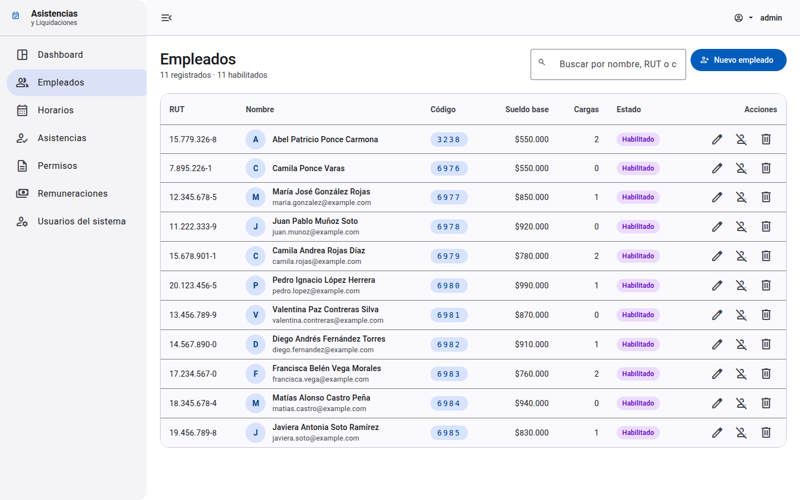
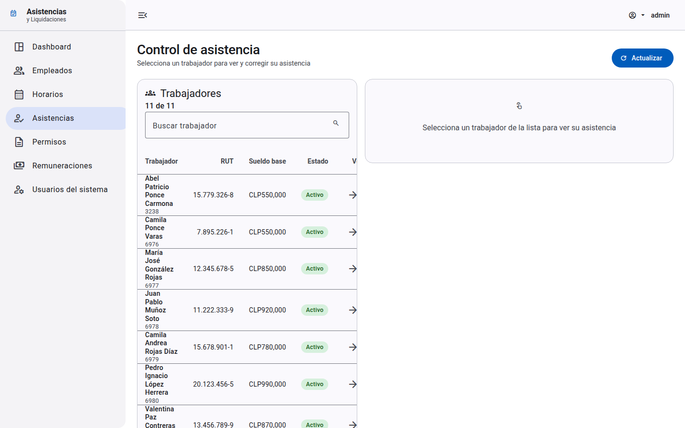
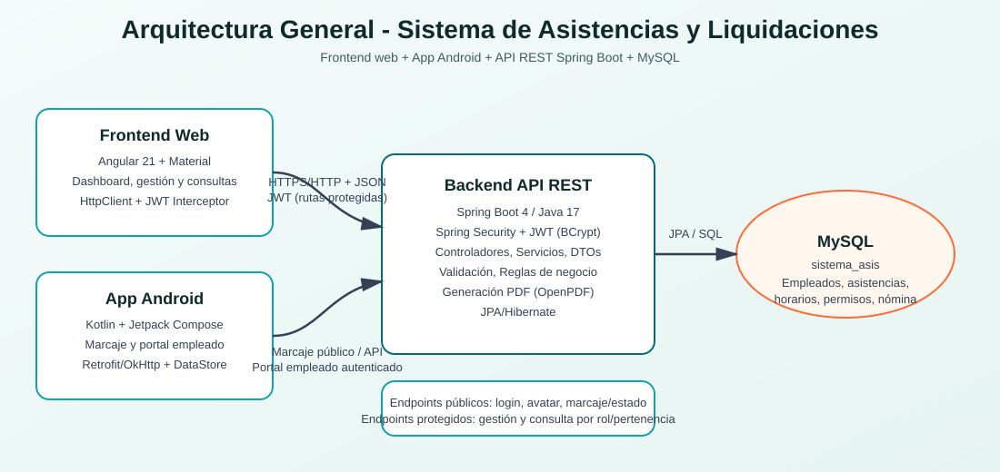
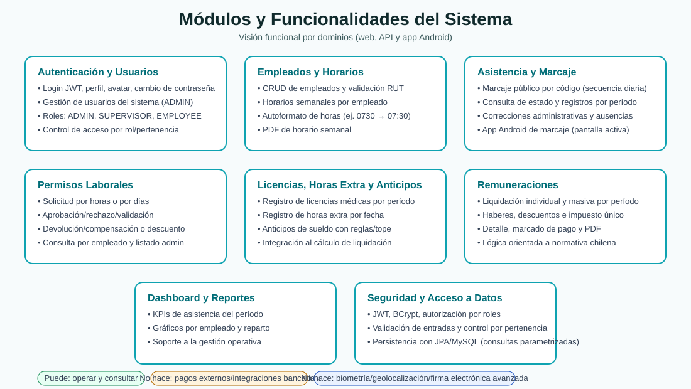
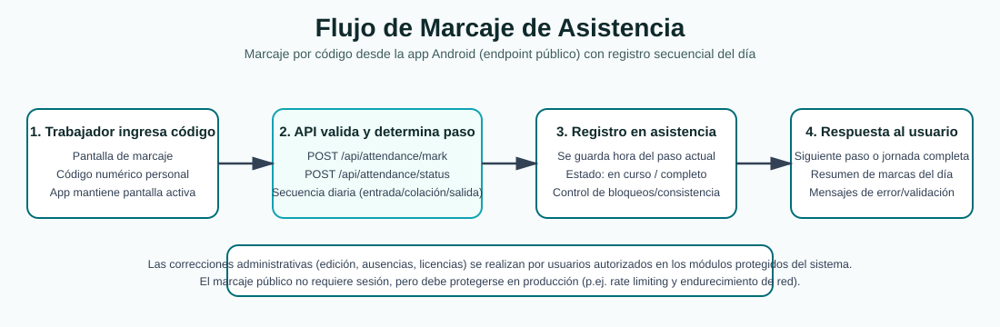

# Sistema de Asistencias y Liquidaciones (Chile)

Aplicación integral para gestionar **asistencia, horarios, permisos laborales y
remuneraciones** de una empresa chilena. El backend implementa las reglas de
jornada con colación, licencias médicas, horas extra, anticipos, gratificación,
asignación familiar, AFP/salud/cesantía e impuesto único, y genera liquidaciones
y horarios en PDF.

El proyecto está dividido en tres módulos que se comunican por una **API REST**:

| Módulo | Tecnología principal | Responsabilidad |
|--------|----------------------|-----------------|
| `backend/` | Java 17 + Spring Boot | API REST, reglas de negocio, seguridad y persistencia |
| `frontend/` | Angular 21 + Angular Material | Panel web de administración y consulta |
| `android/` | Kotlin + Jetpack Compose | Kiosco de marcaje y portal del empleado |

> Los clientes (web y Android) **nunca acceden a la base de datos directamente**:
> solo consumen la API. Los parámetros de conexión se entregan mediante variables
> de entorno y archivos locales no versionados; este documento no incluye valores
> de conexión a la base de datos ni direcciones de otros servidores. Las
> credenciales iniciales de acceso a la web se indican en su propia sección.

---

## Índice

1. [Capturas del sistema](#capturas-del-sistema)
2. [Arquitectura general](#arquitectura-general)
3. [Requisitos funcionales](#requisitos-funcionales)
4. [Requisitos no funcionales y seguridad](#requisitos-no-funcionales-y-seguridad)
5. [Qué hace y qué NO hace el sistema](#qué-hace-y-qué-no-hace-el-sistema)
6. [Tecnologías utilizadas](#tecnologías-utilizadas)
7. [Estructura del repositorio](#estructura-del-repositorio)
8. [Puesta en marcha con Docker Compose](#puesta-en-marcha-con-docker-compose)
9. [Acceso a la página web](#acceso-a-la-página-web)
10. [Desarrollo de cada módulo](#desarrollo-de-cada-módulo)
11. [Contratos de la API](#contratos-de-la-api)
12. [Dominio y reglas de negocio](#dominio-y-reglas-de-negocio)
13. [Documentación adicional](#documentación-adicional)

---

## Capturas del sistema

### Panel web

| Inicio de sesión | Dashboard (KPIs y gráficos) |
|------------------|-----------------------------|
|  |  |

| Administración de empleados | Control de asistencia |
|-----------------------------|-----------------------|
|  |  |

**Remuneraciones y liquidaciones** del período, con horas extra, anticipos y
licencias:


### Aplicación Android

| Kiosco de marcaje | Código ingresado |
|-------------------|------------------|
|  |  |


El flujo del kiosco es simple: la persona ingresa su código de marcaje y la
app registra el siguiente paso del día, mostrando la hora y la acción pendiente.

### Diagramas

**Arquitectura general**



**Módulos y funcionalidades**



**Flujo de marcaje de asistencia**



---

## Arquitectura general

```
Navegador / App Android
        │  HTTP + JSON
        ▼
   API REST (Spring Boot)
        │  JPA / Hibernate
        ▼
   Motor de base de datos (contenedor del stack local)
```

- El **frontend** se sirve con nginx y reenvía `/api/*` al backend dentro de la
  red de contenedores.
- La **app Android** consume la API del backend local; no tiene acceso a la base
  de datos.
- El **backend** es el único componente que habla con la base de datos y el
  único que firma y valida los tokens JWT.
- La configuración sensible se inyecta desde `.env` (ignorado por Git) al
  contenedor del backend; el repositorio solo contiene plantillas con
  marcadores de posición.

---

## Requisitos funcionales

### 1. Autenticación y usuarios del sistema

- Inicio de sesión con usuario y contraseña; emisión de token JWT *stateless*.
- Contraseñas almacenadas con hash BCrypt.
- Roles: **ADMIN**, **SUPERVISOR** y **EMPLOYEE**, con control de acceso en los
  endpoints mediante anotaciones de seguridad.
- Perfil: actualización de nombre, nombre completo, foto (avatar) y contraseña.
- Gestión de cuentas internas según permisos: alta, edición, habilitación y
  deshabilitación.

### 2. Empleados

- Alta, edición, consulta, baja, habilitación/deshabilitación y eliminación.
- Datos personales y laborales: RUT, fecha de ingreso, sueldo base, AFP, salud,
  cargas familiares y datos de contacto.
- Validación de RUT al crear o editar.
- Listado consultable por el panel web y por la app Android (según rol).

### 3. Horarios semanales

- Horario por empleado y por día, con jornadas y períodos de colación.
- Autoformato de horas al ingresar (por ejemplo, `0730` se muestra como `07:30`).
- Alta, edición, eliminación y descarga del horario en PDF.

### 4. Asistencia y marcaje

- Kiosco público de marcaje por código de 4 dígitos: registra entrada, salidas
  a colación, reingresos y salida final, indicando siempre el siguiente paso.
- Consulta del estado del día sin registrar marca.
- Consulta de asistencias por empleado y rango de fechas.
- Correcciones administrativas: completar, ajustar y desbloquear registros.
- Registro de ausencias y visualización de licencias médicas.

### 5. Permisos laborales

- Solicitudes por horas o por días, con motivo y fecha.
- Aprobación, rechazo y compensación/devolución de tiempo.
- Consulta por empleado y listado general según el rol.

### 6. Licencias médicas, horas extra y anticipos

- Registro de licencias médicas por empleado y período.
- Registro de horas extra por fecha.
- Registro de anticipos de sueldo con reglas de negocio por período.

### 7. Remuneraciones y liquidaciones

- Generación y recálculo de la liquidación mensual por empleado.
- Generación masiva del período.
- Cálculo de haberes y descuentos según normativa chilena: sueldo base,
  gratificación, asignación familiar por tramos y cargas, AFP, salud, cesantía,
  impuesto único, descuentos por inasistencias, licencias, permisos y anticipos,
  y horas extra.
- Detalle de liquidación, marcar como pagada y descarga en PDF de una hoja con
  bloque de firma.

### 8. Dashboard y reportes

- Indicadores y gráficos de asistencia del período por empleado.
- Paneles de administración para empleados, horarios, asistencia, permisos y
  remuneraciones.

### 9. Aplicación Android

- Kiosco de marcaje con pantalla siempre activa durante el uso.
- Portal del empleado: inicio de sesión y consulta de asistencias, permisos y
  liquidaciones.
- Sesión JWT persistida localmente y restaurada al reabrir la app.
- Selector de empleado para cuentas que no tienen un empleado asociado.
- Conexión **únicamente al backend local** del proyecto; nunca a otro servidor
  ni a la base de datos de forma directa.

---

## Requisitos no funcionales y seguridad

| Requisito | Implementación |
|-----------|----------------|
| Autenticación | JWT stateless y autorización por roles |
| Contraseñas | Hash BCrypt; nunca se guardan en texto plano |
| Validación | Bean Validation en la API y reglas de negocio en servicios |
| Persistencia | JPA con consultas parametrizadas, sin SQL dinámico concatenado |
| Errores | Manejo centralizado con respuestas uniformes |
| Secretos | Variables de entorno y archivos ignorados por Git; plantillas sin valores reales |
| Red | CORS configurable para los orígenes de desarrollo local |
| Pruebas | Tests de unidad e integración con base de datos en memoria |
| Contenedores | Imágenes multi-etapa, usuario no root en el backend y volumen persistente para los datos |
| Disponibilidad | Healthchecks y arranque ordenado de los servicios del stack |

---

## Qué hace y qué NO hace el sistema

### Lo que hace

| Área | Funcionalidad implementada |
|------|----------------------------|
| Autenticación | Login, JWT, BCrypt, roles y cambio de contraseña/avatar |
| Usuarios | Alta/edición de cuentas internas, habilitar/deshabilitar |
| Empleados | CRUD completo, validación de RUT, alta/baja/eliminación |
| Horarios | Horarios semanales con colaciones, autoformato y PDF |
| Asistencia | Marcaje por código, consultas, correcciones, ausencias y licencias |
| Permisos | Solicitudes por hora/día, aprobación, rechazo y compensación |
| Remuneraciones | Licencias, horas extra, anticipos y liquidación mensual con reglas chilenas |
| Liquidaciones | Generación individual y masiva, detalle, pago y PDF |
| Dashboard | KPIs y gráficos de asistencia del período |
| Web | Panel Angular Material con rutas protegidas y proxy `/api` |
| Android | Kiosco y portal del empleado con JWT persistido y selector de empleado |
| Despliegue | Stack local con contenedores, proxy `/api`, CORS configurable y volumen persistente |

### Lo que NO hace (fuera de alcance)

- **No** conecta el frontend ni la app Android a la base de datos: solo el
  backend accede a ella.
- **No** reemplaza asesoría legal, tributaria, contable ni laboral; los cálculos
  requieren validación normativa según la empresa.
- **No** integra pagos bancarios, Previred, SII ni sistemas RRHH externos.
- **No** incluye firma electrónica avanzada ni flujos documentales complejos más
  allá de los PDF generados.
- **No** implementa biometría, geolocalización, reconocimiento facial ni control
  de dispositivo para el marcaje: el marcaje es solo por código.
- **No** tiene portal de autoservicio web para empleados; el autoservicio está
  en la app Android.
- **No** soporta multiempresa, multitenencia ni internacionalización completa.
- **No** envía notificaciones push, correo ni SMS, y **no** funciona sin conexión.
- **No** exporta a Excel: los reportes descargables son PDF.
- **No** provee HTTPS, limitación de tasa, auditoría avanzada ni recuperación de
  contraseña por correo sin trabajo adicional.
- **No** usa migraciones controladas: el esquema se actualiza automáticamente,
  por lo que se recomienda respaldo antes de actualizar.

---

## Tecnologías utilizadas

| Capa | Tecnologías y versiones |
|------|-------------------------|
| Backend | Java 17, Spring Boot 4.0.8 (Web MVC, Data JPA, Validation, Security), Spring Security + JWT, BCrypt, Hibernate, HikariCP, OpenPDF, Lombok, Maven Wrapper |
| Base de datos | Motor MySQL 8.4 en contenedor con volumen persistente; H2 en memoria para pruebas |
| Frontend | Angular 21.2 (componentes standalone, signals, zoneless), Angular Material 21 (M3), TypeScript 5.9, RxJS 7.8, Chart.js + ng2-charts, SweetAlert2, SCSS, Vitest |
| Android | Kotlin 2.0.20, Jetpack Compose (Material 3), ViewModel + StateFlow, Retrofit + OkHttp + Gson, DataStore, Gradle 8.9 / AGP 8.5.2 (`minSdk 24`, `targetSdk 35`) |
| Docker | Docker Engine con plugin `compose`, imágenes multi-etapa, nginx como proxy inverso, healthchecks |
| Calidad | Tests automatizados del backend con perfil H2 y suite de tests del frontend |

El inventario completo está en
[`docs/REQUISITOS_Y_TECNOLOGIAS.md`](docs/REQUISITOS_Y_TECNOLOGIAS.md).

---

## Estructura del repositorio

```
.
├── backend/            API REST, entidades, servicios, seguridad y PDF
│   ├── Dockerfile      Build multi-etapa con Maven + JRE
│   └── src/            Código fuente y tests
├── frontend/           Panel web Angular
│   ├── Dockerfile      Build multi-etapa con Node + nginx
│   ├── nginx.conf      Proxy /api y fallback SPA
│   └── src/            Componentes, servicios y rutas
├── android/            App Android (Kotlin + Compose)
│   └── local.properties  Configuración local no versionada
├── docs/
│   ├── imagenes/       Capturas y diagramas usados en este README
│   ├── DESPLIEGUE_DOCKER.md
│   └── REQUISITOS_Y_TECNOLOGIAS.md
├── scripts/deploy.sh   Validación y arranque del stack
├── docker-compose.yml  Servicios: base de datos, backend y frontend
├── .env.example        Plantilla de variables de entorno (sin valores reales)
└── README.md           Este documento
```

---

## Puesta en marcha con Docker Compose

### Requisitos previos

- Docker Engine con el plugin `compose`, o Docker Desktop.
- Los puertos definidos en las variables de entorno deben estar libres.
- Git para obtener el código.

### Configuración

1. Copiar la plantilla y editarla:

   ```bash
   cp .env.example .env
   ```

   `.env` está ignorado por Git y es el único lugar donde se colocan los valores
   reales. La plantilla contiene solo marcadores de posición.

2. Revisar las variables. Ninguna de ellas debe escribirse en este README ni
   en el código fuente:

   | Variable | Uso |
   |----------|-----|
   | `HTTP_PORT`, `BACKEND_PORT`, `MYSQL_HOST_PORT` | Puertos publicados en la máquina |
   | `MYSQL_DATABASE`, `MYSQL_ROOT_PASSWORD` | Inicialización del contenedor de base de datos |
   | `DB_URL`, `DB_USERNAME`, `DB_PASSWORD` | Conexión del backend dentro de la red de contenedores |
   | `JWT_SECRET`, `JWT_EXPIRATION_MS` | Firma y expiración de tokens |
   | `ADMIN_USERNAME`, `ADMIN_PASSWORD` | Cuenta inicial del sistema |
   | `COMPANY_NAME`, `COMPANY_RUT` | Datos que aparecen en PDF y liquidaciones |
   | `CORS_ALLOWED_ORIGINS` | Orígenes HTTP permitidos |

   El Compose ya define la URL interna hacia el servicio de base de datos, así
   que no hace falta exponer valores de conexión en la documentación.

### Arranque

```bash
docker compose up -d --build
```

O, de forma resumida:

```bash
chmod +x scripts/deploy.sh
./scripts/deploy.sh
```

Verificación:

```bash
docker compose ps
docker compose logs -f backend
docker compose logs -f frontend
```

El stack levanta tres servicios con orden de arranque y healthchecks: motor de
base de datos, backend y frontend. El esquema se crea automáticamente y la
aplicación queda disponible en la URL HTTP configurada en `HTTP_PORT`.

> Después de cambiar `.env` hay que recrear los contenedores, porque un simple
> `restart` no vuelve a leer el archivo:
>
> ```bash
> docker compose up -d --force-recreate
> ```

La guía completa, incluyendo respaldos y solución de problemas, está en
[`docs/DESPLIEGUE_DOCKER.md`](docs/DESPLIEGUE_DOCKER.md).

---

## Acceso a la página web

Para ingresar al panel web se usa el usuario y la contraseña iniciales que
define el proyecto:

| Campo | Valor |
|-------|-------|
| Usuario | `admin` |
| Contraseña | `admin123` |

Son los valores por defecto del código. Si se quiere otro usuario o otra
contraseña, se deben definir `ADMIN_USERNAME` y `ADMIN_PASSWORD` en el archivo
local `.env` antes de levantar el stack; ese archivo no se sube al repositorio.

---

## Desarrollo de cada módulo

### Backend

```bash
cd backend
./mvnw spring-boot:run     # API en el puerto configurado
./mvnw test                # Tests con base de datos en memoria
```

Para ejecutarlo fuera de contenedores, cargar primero las variables desde
`.env` (sin mostrar ni copiar sus valores):

```bash
set -a && source ../.env && set +a
```

### Frontend

```bash
cd frontend
npm install
npm start                  # servidor de desarrollo con proxy /api
npm run build              # salida de producción
```

El proxy de desarrollo reenvía `/api` al backend local, por lo que debe estar
corriendo. Con Compose no hace falta instalar Node: el frontend se compila
dentro del contenedor.

### App Android

- Abrir `android/` con Android Studio o usar `./gradlew` con el SDK configurado.
- La app apunta **solo al backend local**. La URL se inyecta en `BuildConfig`
  desde `android/local.properties`, archivo ignorado por Git con un valor
  predeterminado para el emulador.
- Para probar en un dispositivo físico, sobrescribir `backend.local.url` en ese
  archivo local con la dirección del backend en la red local.
- No existe selección de otros entornos en la app: no hay código, configuración
  ni referencia a ningún otro servidor.
- La app envía el JWT como cabecera `Authorization: Bearer <token>` mediante un
  interceptor de OkHttp; sin esa cabecera, los endpoints de consulta responden
  `401`.

---

## Contratos de la API

| Método | Ruta | Descripción |
|--------|------|-------------|
| `POST` | `/api/auth/login` | Inicio de sesión y emisión de JWT |
| `GET` | `/api/employees` | Listado de empleados (según rol) |
| `POST` | `/api/attendance/mark` | Registrar el siguiente marcaje por código |
| `POST` | `/api/attendance/status` | Consultar el estado del día |
| `GET` | `/api/attendance/employee/{id}` | Asistencias de un empleado |
| `GET` | `/api/permisos/employee/{id}` | Permisos de un empleado |
| `GET` | `/api/payroll/liquidaciones/employee/{employeeId}` | Liquidaciones de un empleado |
| `GET` | `/api/payroll/liquidaciones/{id}/pdf` | PDF de una liquidación |
| CRUD | Empleados, asistencia, permisos, liquidaciones | Operaciones administrativas según rol |

Las rutas de la app Android ya incluyen el prefijo `/api`, por lo que la URL
base configurada en el cliente debe terminar solo en `/`.

---

## Dominio y reglas de negocio

Entidades principales: empleados, cuentas del sistema y roles, horarios
semanales y días de horario, asistencias, permisos laborales, licencias
médicas, horas extra, anticipos, liquidaciones y su detalle, y parámetros del
sistema.

Reglas implementadas:

- **Licencias médicas**: todos los días solapados se descuentan del sueldo; no
  existe haber de subsidio a cargo del empleador. Los campos históricos que
  quedaron en el esquema se mantienen solo por compatibilidad y ya no se usan.
- **Asistencia**: la vista es maestro/detalle; se lista el personal y se
  consulta la información de cada persona de forma individual.
- **Liquidación**: los anticipos se descuentan como una línea normal dentro del
  bloque de descuentos, sin una sección separada.
- **Horarios**: las horas se normalizan al guardar para mostrarlas en formato
  `HH:mm`.

---

## Documentación adicional

| Documento | Contenido |
|-----------|-----------|
| [`docs/REQUISITOS_Y_TECNOLOGIAS.md`](docs/REQUISITOS_Y_TECNOLOGIAS.md) | Requisitos funcionales, no funcionales, tecnologías, dominio y alcance |
| [`docs/DESPLIEGUE_DOCKER.md`](docs/DESPLIEGUE_DOCKER.md) | Arranque del stack, variables, verificación, respaldos y solución de problemas |
| [`docs/imagenes/arquitectura.svg`](docs/imagenes/arquitectura.svg) | Diagrama de arquitectura |
| [`docs/imagenes/modulos.svg`](docs/imagenes/modulos.svg) | Diagrama de módulos |
| [`docs/imagenes/flujo-marcaje.svg`](docs/imagenes/flujo-marcaje.svg) | Flujo de marcaje |

Toda la configuración con valores reales permanece en archivos locales
ignorados por Git. Este README y la documentación versionada contienen solo
nombres de variables y descripción del comportamiento del sistema.
